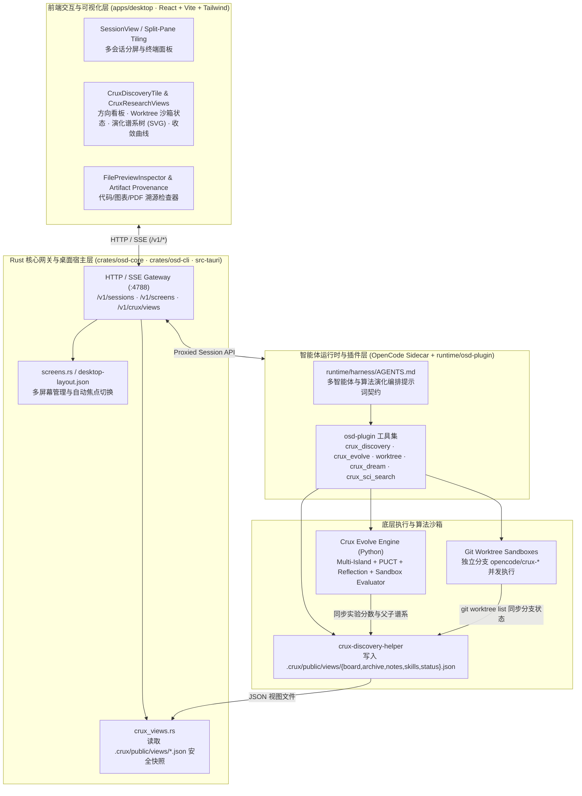

# Crux Desktop 项目技术与使用文档 (v0.7.1)

> **Crux Desktop** —— 本地优先（Local-First）、模型无关（Model-Agnostic）的 AI 科研与多智能体算法演化工作台（支持 Windows、macOS、Linux 桌面端与服务器无头 Web 模式）。
>
> - **GitHub 仓库**：[https://github.com/zjhkeyan/crux-desktop](https://github.com/zjhkeyan/crux-desktop)
> - **最新版本发布 (`v0.7.1`)**：[https://github.com/zjhkeyan/crux-desktop/releases/tag/v0.7.1](https://github.com/zjhkeyan/crux-desktop/releases/tag/v0.7.1)

---

## 目录

1. [项目定位与核心特性](#1-项目定位与核心特性)
2. [系统整体架构](#2-系统整体架构)
3. [代码仓库目录结构](#3-代码仓库目录结构)
4. [安装与快速启动指南](#4-安装与快速启动指南)
5. [核心引擎详解：Crux Discovery、Crux Evolve 与 Git Worktree](#5-核心引擎详解crux-discoverycrux-evolve-与-git-worktree)
6. [多智能体并行探索工作流与提示词指南](#6-多智能体并行探索工作流与提示词指南)
7. [内置工具与 CLI 命令行手册](#7-内置工具与-cli-命令行手册)
8. [看板数据契约与前端可视化机制](#8-看板数据契约与前端可视化机制)
9. [源码构建与 GitHub Actions 跨平台打包](#9-源码构建与-github-actions-跨平台打包)

---

## 1. 项目定位与核心特性

**Crux Desktop** 将自主科研智能体（Autonomous Research Agents）、多岛屿进化算法引擎（Multi-Island Evolutionary Engine）、Git Worktree 并发沙箱隔离以及可回溯工件视图整合成一套统一的桌面与服务器工作台：

| 核心模块 | 功能定位 | 关键实现 |
| :--- | :--- | :--- |
| **Crux Discovery (`crux_discovery`)** | 多智能体科研探索看板：管理探索方向（`directions`）、假设认领（`claim`）、实验分数排行榜（`archive`）、团队经验（`notes`）与技能沉淀（`skills`） | [`runtime/osd-plugin/research-tools.ts`](../runtime/osd-plugin/research-tools.ts)、[`CruxDiscoveryTile.tsx`](../apps/desktop/src/components/canvas/CruxDiscoveryTile.tsx) |
| **Crux Evolve (`crux_evolve`)** | 多岛屿算法自动演化引擎（原 `LLM4AD-Next`）：内置 PUCT 树搜索、双通道选择（Score-Proportional + Rank）、交叉/变异、反思记忆（Reflection Memory）与防作弊沙箱评测 | [`runtime/skills/crux/crux-evolve/`](../runtime/skills/crux/crux-evolve/) |
| **Git Worktree 沙箱 (`worktree`)** | 并发代码隔离沙箱：每个子智能体或探索方向拥有独立的 Git 分支（`opencode/crux-<slug>`）与物理工作树，彻底消除多智能体并发改写冲突 | [`runtime/osd-plugin/worktree.ts`](../runtime/osd-plugin/worktree.ts)、[`runtime/worktree/`](../runtime/worktree/) |
| **Crux Screen 与无头网关 (`crux`)** | 桌面端（Tauri 2）与服务器端（`crux server`）共享同一套 React Web UI 与 HTTP/SSE 网关，支持智能体自动新建并弹出可视化分屏（`crux screen new` + `crux screen show`） | [`crates/osd-core/src/gateway.rs`](../crates/osd-core/src/gateway.rs)、[`crates/osd-cli/`](../crates/osd-cli/) |
| **Agent Memory (`crux_dream`)** | 跨会话分层记忆系统：支持长期经验蒸馏（`dream`）、项目记忆检索与更新 | [`runtime/osd-plugin/memory.ts`](../runtime/osd-plugin/memory.ts)、[`runtime/skills/core/agent-memory/`](../runtime/skills/core/agent-memory/) |

---

## 2. 系统整体架构



---

## 3. 代码仓库目录结构

```text
crux-desktop/
├── apps/
│   └── desktop/                        # 前端与 Tauri 桌面客户端
│       ├── src/
│       │   ├── components/
│       │   │   ├── canvas/
│       │   │   │   └── CruxDiscoveryTile.tsx     # 方向看板、Worktree 状态、内嵌演化谱系与排行榜
│       │   │   ├── inspector/
│       │   │   │   └── CruxResearchViews.tsx     # 演化谱系树 (Lineage SVG)、收敛曲线、安全防护面板
│       │   │   ├── remote/                       # 远程算力连接向导、任务工作台与结果回收
│       │   │   ├── session/                      # 分屏平铺 (GroupTabs / ContentPane / SessionView)
│       │   │   └── thread/                       # 对话消息流、工具调用渲染与 Composer
│       └── src-tauri/                            # Tauri 2 Rust 桌面壳、NSIS/MSI 打包配置与原生能力
├── crates/
│   ├── osd-core/                       # 核心后端库 (Gateway、Screen 管理、Crux 视图解析、SSH 隧道、终端守护)
│   │   └── src/
│   │       ├── gateway.rs              # HTTP API 路由 (/v1/screens, /v1/crux/views, /v1/sessions 等)
│   │       ├── crux_views.rs           # .crux/public/views/*.json 零跟随符号链接安全读取
│   │       ├── crux_bridge.rs          # Crux 工具链与环境桥接
│   │       └── screens.rs              # desktop-layout.json 分屏持久化与自动切换
│   └── osd-cli/                        # `crux` (兼容 `osd`) 命令行客户端与无头服务端入口
├── runtime/
│   ├── harness/
│   │   └── AGENTS.md                   # 全局智能体系统提示词与多任务/算法演化自动触发规则
│   ├── osd-plugin/                     # OpenCode 插件层（向智能体暴露原生工具）
│   │   ├── index.ts                    # 插件入口：注册 crux_discovery, crux_evolve, worktree 等工具
│   │   ├── research-tools.ts           # crux_discovery / crux_evolve / crux_sci_search 实现
│   │   ├── worktree.ts                 # Git Worktree 创建、合并、重置、删除生命周期管理
│   │   └── memory.ts                   # crux_dream 跨会话记忆巩固工具
│   ├── skills/
│   │   ├── core/
│   │   │   ├── multi-agent-orchestration/  # 多智能体并行探索与看板联动规范
│   │   │   ├── agent-memory/               # 记忆蒸馏适配器
│   │   │   ├── literature-review/          # 学术文献检索与综述生成
│   │   │   └── osd-agents/                 # 跨会话/跨终端通信指南
│   │   └── crux/
│   │       └── crux-evolve/            # Crux Evolve 多岛屿算法演化引擎 (Python)
│   │           ├── crux_evolve_adapter.py  # 连接 Crux 看板与底层进化循环的适配器
│   │           └── engine/src/crux_evolve/ # 核心算法库 (islands, puct, selection, reflection, evaluator)
│   └── worktree/                       # Git Worktree 底层状态机与符号链接安全校验
├── scripts/
│   ├── dev/                            # 跨平台 sidecar 获取与构建脚本 (build-osd-sidecar.sh 等)
│   └── release/                        # 独立无头发布包打包脚本 (package-osd.sh)
└── .github/workflows/
    └── build.yml                       # GitHub Actions 自动化编译与 Release 发布流水线
```

---

## 4. 安装与快速启动指南

### 4.1 Windows 安装与启动（推荐）

从 [GitHub Releases (`v0.7.1`)](https://github.com/zjhkeyan/crux-desktop/releases/tag/v0.7.1) 下载对应安装包：

1. **桌面安装版（首选）**：下载并运行 [`Crux_0.7.1_x64-setup.exe`](https://github.com/zjhkeyan/crux-desktop/releases/download/v0.7.1/Crux_0.7.1_x64-setup.exe)
   - 按当前用户安装，无需管理员权限。
   - 若出现 Windows SmartScreen 提示，点击 **更多信息 (More info) -> 仍要运行 (Run anyway)**。
   - 首次启动后会自动将 `crux` CLI 配置到终端 `PATH` 中。
2. **免安装便携版 / 命令行版**：下载 [`osd-0.7.1-x86_64-pc-windows-msvc.zip`](https://github.com/zjhkeyan/crux-desktop/releases/download/v0.7.1/osd-0.7.1-x86_64-pc-windows-msvc.zip)
   - 解压后直接运行 `./crux.exe server` 即可在浏览器打开完整工作台。

### 4.2 Linux / 服务器无头模式（Headless Web UI）

在 Linux 服务器或远程计算节点上，可直接通过 `crux server` 启动完整的 Web 工作台：

```bash
# 1. 配置模型提供商 API Key（例如 DeepSeek / OpenAI / Anthropic）
crux auth set deepseek --key sk-your-api-key
crux model set deepseek/deepseek-chat

# 2. 设置无人值守自动审批（可选，适合全自动多智能体实验）
crux approval set full

# 3. 启动无头网关服务（监听 4788 端口并允许局域网/隧道访问）
crux server --port 4788 --lan --workspace ~/Documents/ScienceCowork
```

启动后访问终端打印的带 `?token=...` 的 URL，即可在任意浏览器中使用与桌面客户端完全一致的界面。

---

## 5. 核心引擎详解：Crux Discovery、Crux Evolve 与 Git Worktree

### 5.1 Crux Discovery (`crux_discovery`) —— 多智能体科研探索看板

`crux_discovery` 是多智能体协同攻关的共享状态中枢，所有状态实时持久化在工作区的 `.crux/public/views/` 目录下：

- **`init`**：初始化研究目标（`goal`）并清空或创建 `.crux/public/views/` 视图。
- **`propose`**：提出新的探索方向（如 `dir-2opt`、`dir-sa`、`dir-ga`）与理论假设。
- **`claim`**：子智能体认领某个探索方向，将其状态置为 `active (探索中)`。
- **`log_attempt`**：记录单次实验尝试的代码哈希（`hash`）、父节点哈希（`parent_hash`）、所属方向（`direction_id`）、评估得分（`score`）与改动摘要，自动计算代际深度（`generation`）并触发 `git worktree list` 同步沙箱状态。
- **`complete`**：完成某个方向的阶段性验证，记录最佳得分并将最后一次尝试标记为 `kept`。
- **`share_note` / `share_skill`**：在多智能体之间共享实验洞察（`notes.json`）或可复用的辅助函数/脚本（`skills.json`）。

### 5.2 Crux Evolve (`crux_evolve`) —— 多岛屿算法自动进化引擎

位于 [`runtime/skills/crux/crux-evolve/`](../runtime/skills/crux/crux-evolve/)，用于解决具有明确数值评估指标（Score / Loss / 吞吐量 / 路径长度）的算法发现与优化问题：

- **多岛屿并行演化 (`IslandManager`)**：将种群划分为多个独立演化的岛屿（Islands），避免过早陷入局部最优，并定期通过环形拓扑（Ring Topology）迁移精英个体（Elites）。
- **PUCT + 双通道父代选择 (`puct.py` / `selection.py`)**：结合 AlphaZero 风格的 PUCT 探索奖励与 50% 分数比例 + 50% 排名概率的双通道选择。
- **短期与长期反思记忆 (`reflection.py`)**：对父代与子代的性能差异（Diff + Score Delta）进行归因分析，提炼出指导下一代变异的进化原则。
- **沙箱防作弊评估 (`evaluator.py`)**：在子进程沙箱中执行候选代码，支持超时强杀、内存限制、NaN/Inf 过滤以及源码篡改检测（防止智能体修改评测脚本作弊）。
- **与看板自动联动**：每一代评估完成后，自动向 `.crux/public/views/board.json` 与 `archive.json` 写入带 `parent_hash` 和 `generation` 的谱系记录。

### 5.3 Git Worktree (`worktree`) —— 并发代码隔离沙箱

当主智能体派生多个并行探索方向时，通过 `worktree(action="create", slug="...")` 为每个方向创建独立的 Git 分支与工作树目录：
- 各个子智能体在各自的 Worktree 目录中独立编写代码、运行基准测试，互不覆盖。
- 每次调用 `crux-discovery-helper` 时，系统自动扫描 `git worktree list --porcelain`，将活跃分支名、Commit Hash、工作树路径实时写入 `board.json` 的 `worktrees` 字段，并在「方向看板」首页展示。

---

## 6. 多智能体并行探索工作流与提示词指南

### 6.1 自动触发机制

在 [`runtime/harness/AGENTS.md`](../runtime/harness/AGENTS.md) 与 [`multi-agent-orchestration/SKILL.md`](../runtime/skills/core/multi-agent-orchestration/SKILL.md) 中内置了自动识别规则。只要用户的自然语言请求涉及：
- **对比多种方法 / 多方向探索**
- **算法调优 / 启发式设计 / 数学与组合优化 / 寻找更优解**
- **并行实验 / 基准评测对比**

智能体就会自动拉起以下完整闭环，**无需用户手写任何工具名称**：

1. **弹出可视化看板屏幕**：调用 `crux screen new "算法探索看板" --view crux-discovery` 并执行 `crux screen show <screen_id>`，前端立即切换到实时看板。
2. **立项并拆解 2～3 个探索方向**：调用 `crux_discovery(action="init")` 与 `propose`。
3. **创建 Git Worktree 沙箱**：调用 `worktree(action="create")` 为不同路线建立隔离分支。
4. **启动算法演化或多代迭代**：调用 `crux_evolve` 或派生并行子智能体（`task`），进行 Baseline -> 变异改进 -> 跨代交叉融合（通过 `parent_hash` 建立 `Gen 0 -> Gen 1 -> Gen 2` 演化树）。
5. **汇总最优解**：在全部方向收敛后汇报排行榜最优方案与实验结论。

### 6.2 推荐的自然语言测试提示词

你只需要在对话框输入简短的一句话即可触发完整的多智能体 + Worktree + 演化谱系可视化：

- **示例 1（组合优化）**：
  > `帮我生成 40 个城市的随机坐标，并行探索几种不同的启发式算法求解 TSP 最短路径，对比收敛效果并找出最优解。`
- **示例 2（经典算法发现）**：
  > `请设计并演化一个在线装箱问题（Online Bin Packing）的评分启发式函数，在随机测试集上不断迭代降低空闲空间比例。`
- **示例 3（机器学习特征/超参优化）**：
  > `尝试多种不同的特征工程与正则化策略来优化当前数据集的回归预测精度，并行对比各方案的交叉验证得分。`

---

## 7. 内置工具与 CLI 命令行手册

### 7.1 智能体内置插件工具 (`runtime/osd-plugin`)

| 工具名 | 主要参数 | 说明 |
| :--- | :--- | :--- |
| **`crux_discovery`** | `action`: `init` \| `status` \| `propose` \| `claim` \| `complete` \| `log_attempt` \| `share_note` \| `share_skill`<br>`id`, `title`, `score`, `parent_hash`, `direction_id`, `description`, `hypothesis`, `agent` | 管理多智能体探索看板、实验排行榜、演化谱系与共享笔记 |
| **`crux_evolve`** | `action`: `init` \| `run` \| `status`<br>`task_name`, `eval_command`, `target_file`, `direction` (`maximize`/`minimize`), `generations`, `islands` | 启动或查询多岛屿进化算法引擎 |
| **`worktree`** | `action`: `create` \| `list` \| `status` \| `merge` \| `reset` \| `delete`<br>`slug`, `message` | 管理并发实验的 Git Worktree 隔离沙箱 |
| **`crux_dream`** | `action`: `consolidate` \| `status` | 蒸馏历史实验记录与会话，生成持久化的跨会话研究记忆 |
| **`crux_sci_search`** | `query`, `source` (`arxiv`/`semantic_scholar`/`crossref`), `max_results` | 检索学术文献并返回结构化标题、摘要、DOI 与引用元数据 |
| **`computer`** | `action`: `screenshot` \| `click` \| `type` \| `key` \| `scroll` | 跨平台桌面 GUI 自动化操作（支持 Windows UIA、macOS Accessibility、Linux AT-SPI） |

### 7.2 `crux` CLI 常用命令

```bash
# 服务与会话管理
crux server [--port 4788] [--lan] [--workspace <dir>]   # 启动无头网关与 Web UI
crux session ls                                         # 列出所有会话
crux session new --title "TSP 实验"                     # 创建新会话
crux session send <session-id> "提示词" --wait          # 发送消息并等待该轮执行完成

# 分屏与可视化看板管理
crux screen ls                                          # 列出当前所有屏幕分栏
crux screen new "方向看板" --view crux-discovery         # 新建 Crux Discovery 看板屏幕
crux screen show <screen-id>                            # 立即将前端焦点切换到指定屏幕

# 模型与权限管理
crux auth set <provider> --key <api-key> [--base-url <url>]
crux model ls                                           # 查看可用模型列表
crux model set <provider/model>                         # 设置默认模型
crux approval set full | approve                        # 设置全自动执行或人工审批模式
```

---

## 8. 看板数据契约与前端可视化机制

前端看板组件 [`CruxDiscoveryTile.tsx`](../apps/desktop/src/components/canvas/CruxDiscoveryTile.tsx) 与 [`CruxResearchViews.tsx`](../apps/desktop/src/components/inspector/CruxResearchViews.tsx) 每 **1.5 秒** 自动轮询后端的 `GET /v1/crux/views/:view?directory=<workspace>` 接口，读取 `<workspace>/.crux/public/views/` 下的 5 个核心 JSON 文件：

1. **`board.json`**：
   - `goal`：当前研究总目标
   - `directions`：探索方向数组（`id`, `title`, `status`, `owner`, `hypothesis`, `best_score`）
   - `worktrees`：Git Worktree 沙箱状态数组（`branch`, `commit`, `path`, `is_main`）
   - `attempts`：所有实验尝试记录（含 `hash`, `parent_hash`, `direction_id`, `generation`, `score`, `status`, `description`）
   - `status_feed`：实时事件时间线
2. **`archive.json`**：
   - `leaderboard`：按得分排序的全局实验排行榜
   - `attempts`：完整演化尝试列表，驱动 **Evolution Lineage 演化谱系树（SVG 节点连线图）** 与 **Score Convergence 收敛曲线**
3. **`notes.json`**：多智能体共享的实验洞察与失败教训
4. **`skills.json`**：探索过程中沉淀的可复用代码算子与工具脚本
5. **`status.json`**：当前活跃智能体心跳与运行状态

---

## 9. 源码构建与 GitHub Actions 跨平台打包

### 9.1 本地开发与编译

**前置依赖**：Node.js >= 20、`pnpm` 9、Rust stable 工具链、Python 3.10+。

```bash
# 1. 安装前端与 Workspace 依赖
pnpm install --frozen-lockfile

# 2. 拉取平台对应的运行时 sidecar (opencode, uv, agent-browser, skills)
bash scripts/dev/fetch-opencode.sh
bash scripts/dev/fetch-uv.sh
bash scripts/dev/fetch-agent-browser.sh
bash scripts/dev/fetch-skills.sh

# 3. 编译前端并构建内嵌 Web UI 的 crux Rust 二进制文件
bash scripts/dev/build-osd-sidecar.sh $(rustc -vV | sed -n 's/host: //p')

# 4. 运行单元测试
pnpm --dir apps/desktop test
cargo test --workspace

# 5. 构建桌面端安装包 (Tauri) 或无头发布包
pnpm --filter @ai4s/desktop tauri build
bash scripts/release/package-osd.sh $(rustc -vV | sed -n 's/host: //p')
```

### 9.2 GitHub Actions 自动打包 Windows `.exe`

仓库内置了 [`.github/workflows/build.yml`](../.github/workflows/build.yml) 流水线，支持两种触发方式：

1. **推送版本标签自动发版**：
   ```bash
   git tag -f v0.7.1
   git push origin v0.7.1 --force
   ```
   推送 `v*` 标签后，GitHub Actions 的 `windows-latest` 构建机会自动完成前端编译、`crux.exe` 编译、Tauri NSIS/MSI 打包，并将以下三个产物自动挂载到 **GitHub Releases**：
   - `Crux_<version>_x64-setup.exe`（Windows 桌面安装程序）
   - `Crux_<version>_x64_en-US.msi`（Windows MSI 安装包）
   - `osd-<version>-x86_64-pc-windows-msvc.zip`（Windows 免安装独立便携版）

2. **通过 GitHub CLI 手动触发构建**：
   ```bash
   gh workflow run build.yml -R zjhkeyan/crux-desktop --ref master
   ```
